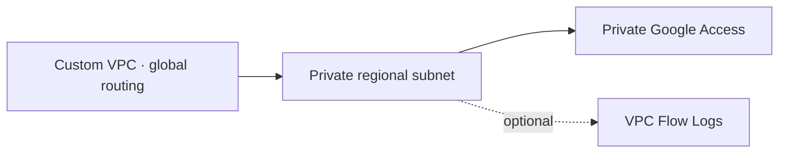

# GCP Secure Platform Baseline

A portfolio lab for a custom Google Cloud VPC and private regional subnet managed with Terraform. The network uses explicit subnet allocation and keeps flow logs disabled by default to avoid unexpected logging charges.

## What this demonstrates

- Terraform provider and version constraints
- Custom-mode VPC networking rather than implicit auto subnets
- Private Google Access for private workloads
- Optional subnet flow logs with an explicit cost decision
- Credential-free CI validation and plan-first operations

## Architecture



## Prerequisites

- Terraform 1.7+
- A Google Cloud project with billing configured if you choose to apply resources
- Application Default Credentials locally, or Workload Identity Federation in automation
- Set `project_id` in `terraform.tfvars` or pass it with `-var`

## Try it safely

```sh
cp terraform.tfvars.example terraform.tfvars
# Replace the example project_id with a project you control.
terraform init
terraform fmt -check -recursive
terraform validate
terraform plan
```

The repository never runs `terraform apply`. Planning against a real project requires credentials and queries that project. Review the target project and plan before any apply. The configuration creates networking resources only if applied; no VM, GKE cluster, NAT, or firewall allow rule is included.

## Security and cost notes

- Custom VPCs have no automatically created subnets or permissive ingress rules.
- Flow logs are disabled by default; enabling them may incur Cloud Logging charges.
- Production state belongs in an encrypted, access-controlled remote backend, never in Git.
- Never commit `terraform.tfvars`, state, credentials, or private keys.

## Next steps

Add a separately reviewed GKE layer, Workload Identity, private control plane options, and environment-level policy checks. Include cost estimates and teardown steps before enabling paid resources.

## License

MIT. See [LICENSE](LICENSE).
